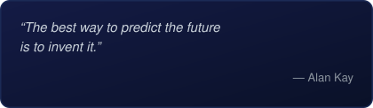

<!-- ============ ABOUT ME ============ -->

## ✨ About Me

Hi! I'm a Software Engineering student and aspiring software developer passionate about technology, problem-solving, and building useful applications.

**Languages and Technologies:**

- C, C++, Java, Python, JavaScript, and TypeScript
- HTML, CSS, and Bootstrap

I'm continuously learning, improving my programming skills, and working on projects to turn ideas into practical solutions.

I'm especially interested in software development, backend engineering, and exploring how technology can solve real-world problems.

 

---

## 💻 Tech Stack

  
  
  
  
  
  
  

  
  
  
  
  
  

  
  
  
  
  
  
  

  
  
  
  
  
  

---

## 🚀 Featured Projects

<table>
  <tr>
    <td width="50%" valign="top">
      <h3>&lt;/&gt; Project Name</h3>
      
A short description of what the project does and the technologies used.

      
      
      
       <a href="https://github.com/lukedevbr/REPO-1">View Repository ↗</a>
    </td>
    <td width="50%" valign="top">
      <h3>🐍 Project Name</h3>
      
A short description of what the project does and the technologies used.

      
      
      
       <a href="https://github.com/lukedevbr/REPO-2">View Repository ↗</a>
    </td>
  </tr>
  <tr>
    <td width="50%" valign="top">
      <h3>🌐 Project Name</h3>
      
A short description of what the project does and the technologies used.

      
      
      
       <a href="https://github.com/lukedevbr/REPO-3">View Repository ↗</a>
    </td>
    <td width="50%" valign="top">
      <h3>🗄️ Project Name</h3>
      
A short description of what the project does and the technologies used.

      
      
      
       <a href="https://github.com/lukedevbr/REPO-4">View Repository ↗</a>
    </td>
  </tr>
</table>

---

## 📊 GitHub Stats

  
  
  

---

<table>
  <tr>
    <td width="33%" valign="top">
      <h3>🏆 GitHub Trophies</h3>
      
    </td>
    <td width="33%" valign="top">
      <h3>💬 Random Dev Quote</h3>
      
    </td>
    <td width="33%" valign="top">
      <h3>📘 Top Contributed Repo</h3>
      <table>
        <tr><td>1</td><td><a href="https://github.com/lukedevbr/REPO-1">project-name</a></td></tr>
        <tr><td>2</td><td><a href="https://github.com/lukedevbr/REPO-2">another-project</a></td></tr>
        <tr><td>3</td><td><a href="https://github.com/lukedevbr/REPO-3">web-app</a></td></tr>
        <tr><td>4</td><td><a href="https://github.com/lukedevbr/REPO-4">learning</a></td></tr>
        <tr><td>5</td><td><a href="https://github.com/lukedevbr/REPO-5">more-projects</a></td></tr>
      </table>
    </td>
  </tr>
</table>

---

  

